<div align="center">

# 🏙️ Market Analyzer

### From raw short-term rental data to market intelligence and explainable price estimates.

**An end-to-end data science and full-stack application built around Istanbul's short-term rental market.**

<p>
  
  
  
</p>
<p>
  
  
  
  
  
  
  
</p>

**[Explore the analytics](#exploratory-data-analysis) · [See the models](#machine-learning-results) · [API reference](#api-reference) · [Run locally](#getting-started) · [Roadmap](#project-roadmap)**

</div>

---

## Overview

**Dynamic Market Analyzer** is a full-stack analytics project that transforms public short-term rental listings into a **reproducible data pipeline**, **market segmentation**, **nightly-price predictions**, and a **responsive web dashboard**.

It is designed around two connected systems:

- **Research pipeline:** ingest, validate, clean, analyze, and model historical listing data.
- **Serving application:** load trained models once, validate property inputs, return predictions and market statistics through an API, and present the results in React.

The current implementation covers **Phases 1–8**: ingestion, cleaning, EDA, clustering, supervised learning, FastAPI, a five-page bilingual React interface, and automated quality checks. Public deployment and final portfolio packaging remain future work.

> [!IMPORTANT]
> **What the model predicts:** an *advertised nightly listing price* in Turkish lira (TRY). It does **not** predict actual bookings, occupancy, revenue, profit, or a guaranteed achievable rental rate.

### Project at a glance

| | Recorded result |
|---|---:|
| 📥 Rows entering the cleaning pipeline | **27,232** |
| ✅ Analysis-ready listings | **16,558** |
| 🧩 Discovered market segments | **3** |
| 🏆 Selected price model | **HistGradientBoosting** |
| 📉 Latest holdout MAE | **TRY 1,971.70** |
| 📊 Reported holdout R² | **0.24** |
| 🌐 Implemented dashboard pages | **5** |
| 🧪 Quality tooling | **pytest · Ruff · ESLint · TypeScript · CI workflow** |

*Dataset counts come from `data/processed/data_quality_report.json`; model results come from the current `reports/model_metrics.json` artifact for the September 2026 Istanbul snapshot.*

## Table of contents

- [Features](#features)
- [System architecture](#system-architecture)
- [Technology stack](#technology-stack)
- [Dataset and data pipeline](#dataset-and-data-pipeline)
- [Exploratory data analysis](#exploratory-data-analysis)
- [Machine learning results](#machine-learning-results)
- [Web dashboard](#web-dashboard)
- [API reference](#api-reference)
- [Getting started](#getting-started)
- [Testing and continuous integration](#testing-and-continuous-integration)
- [Project structure](#project-structure)
- [Engineering decisions](#engineering-decisions)
- [Limitations](#limitations)
- [Project roadmap](#project-roadmap)
- [Data attribution and references](#data-attribution-and-references)

## Features

| Area | Implemented capabilities |
|---|---|
| **Data ingestion** | Dockerized PostgreSQL, parameterized ingestion, atomic table replacement, row-count verification |
| **Data quality** | Price parsing, geographic and amenity features, explicit filtering rules, validation checks, auditable Parquet outputs |
| **Market analytics** | Price distributions, neighbourhood medians, geographic price patterns, amenity comparisons |
| **Unsupervised ML** | K-Means segmentation, elbow/silhouette evaluation, saved cluster profiles, segment labels |
| **Supervised ML** | Median baseline, Linear Regression, Ridge Regression, HistGradientBoosting; saved preprocessing/model pipeline |
| **API** | Typed FastAPI endpoints for predictions, market statistics, form options, distribution, model metrics, and data quality |
| **Frontend** | React + TypeScript pages for overview, prediction, segments, model evaluation, and data-pipeline quality |
| **Experience** | Responsive desktop/mobile navigation, light/dark themes, full English/Turkish UI, accessible labels, data-driven form options |
| **Reliability** | Backend unit/contract tests, Ruff, frontend ESLint and TypeScript production builds, CI workflow definition |

## System architecture

The system separates **offline model development** from **online inference**. Prediction requests use saved artifacts; they do not retrain models.

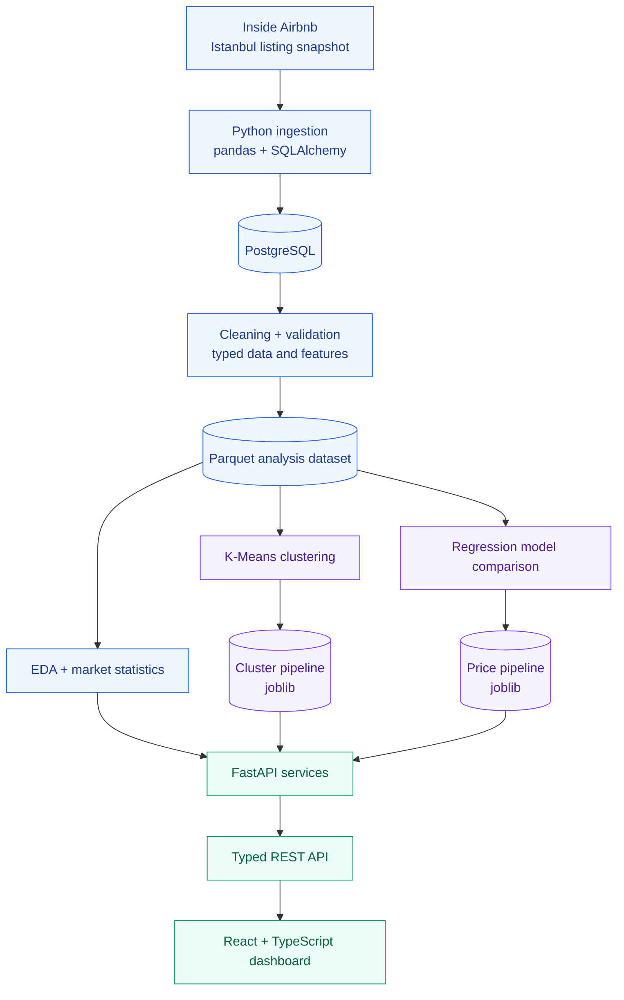

**Inference sequence:** the API predicts a price first, then supplies that estimated price to the price-sensitive clustering model to assign a market segment. This resolves the difference between the clustering feature schema and the inputs available for a new listing.

## Technology stack

| Layer | Technology | Purpose |
|---|---|---|
| Data source | [Inside Airbnb](https://insideairbnb.com/get-the-data/) | Public listing snapshots |
| Storage | PostgreSQL 15, Docker Compose | Reproducible relational database |
| Ingestion | Python, pandas, SQLAlchemy, psycopg | Load and manage source records |
| Processing | pandas, NumPy, Parquet, PyArrow | Cleaning and feature engineering |
| Analysis | Matplotlib | Research charts and market reports |
| ML | scikit-learn, joblib | Clustering, regression, serialization |
| Backend | FastAPI, Pydantic, Uvicorn | Validated inference and market API |
| Frontend | React 19, TypeScript 6, Vite 8 | Browser application |
| UI | Tailwind CSS 4, Lucide React | Responsive interface, theme system, and icons |
| Charts | Recharts | Interactive dashboard visualizations |
| Quality | pytest, Ruff, ESLint, TypeScript | Backend tests and frontend static/build verification |

## Dataset and data pipeline

**Market:** Istanbul, Türkiye · **Snapshot:** September 2026 · **Currency:** TRY  
**Source:** [Inside Airbnb — Get the Data](https://insideairbnb.com/get-the-data/)

The project begins with the detailed `listings.csv.gz` snapshot. Raw inputs remain immutable. Cleaned analytical datasets and reports are regenerated from the source.

### Data flow

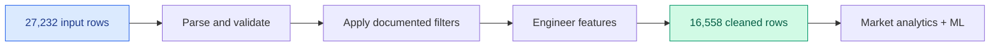

### Processing decisions

| Decision | Rationale |
|---|---|
| **Immutable raw data** | Every transformation can be audited and reproduced |
| **Parameterized ingestion** | Scripts accept city, snapshot, and table arguments |
| **Atomic ingestion** | Back up, load, verify, then promote or roll back |
| **Small insert batches** | Avoid PostgreSQL parameter limits for wide source tables |
| **Long-stay filtering** | Exclude misleading monthly/long-stay pricing patterns (`minimum_nights >= 30`) |
| **Missing-value policy** | Preserve missingness where appropriate; fit ML imputers on training data only |
| **Feature engineering** | Numeric price, `amenity_count`, and `distance_to_center_km` |
| **Validation report** | Record row counts, null counts, and cleaning decisions |

The analysis-ready dataset is saved to `data/processed/listings_clean.parquet`; its audit information is written to `data/processed/data_quality_report.json`.

**Detailed documentation:** [Data-quality report](data/processed/data_quality_report.json) · [Data layout](data/README.md)

## Exploratory data analysis

The market analysis answers four practical questions: *How are prices distributed? Where are listings more expensive? Are prices geographically clustered? Which amenities are associated with price differences?*

### 1. Price distribution

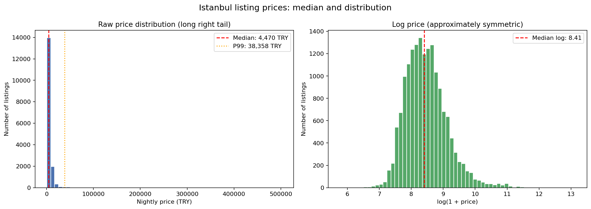

Istanbul listing prices exhibit a **strong right-skew**. The analysis compares raw and log-transformed prices, and uses medians and percentiles rather than relying on a mean distorted by extreme listings.

### 2. Neighbourhood comparisons

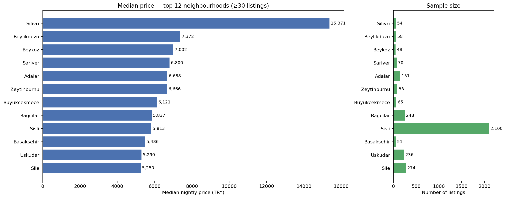

Neighbourhoods are ranked by **median advertised nightly price**, with a **minimum sample of 30 listings per neighbourhood** to avoid interpreting unstable, very-small-sample rankings.

### 3. Geographic patterns

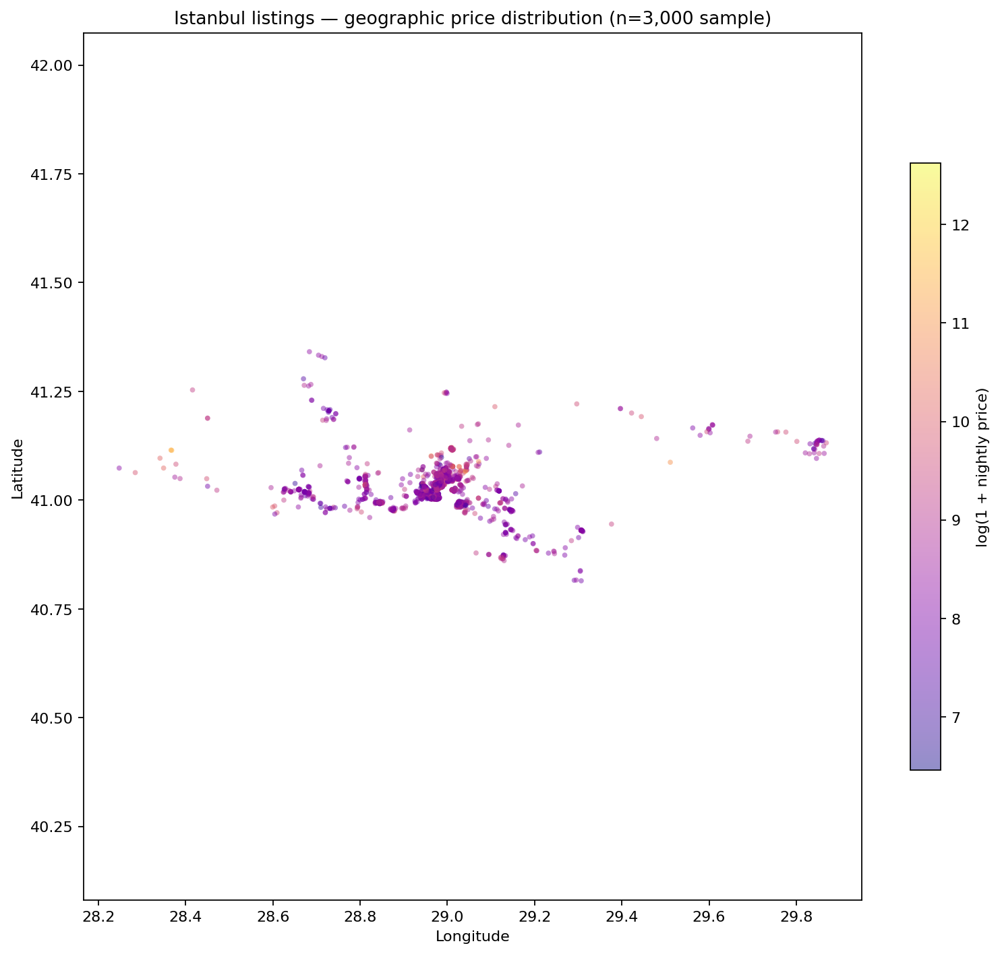

A sampled geographic scatter plot uses log-price colouring and transparency to reveal geographic structure without hiding the map under thousands of overlapping points.

### 4. Amenity associations

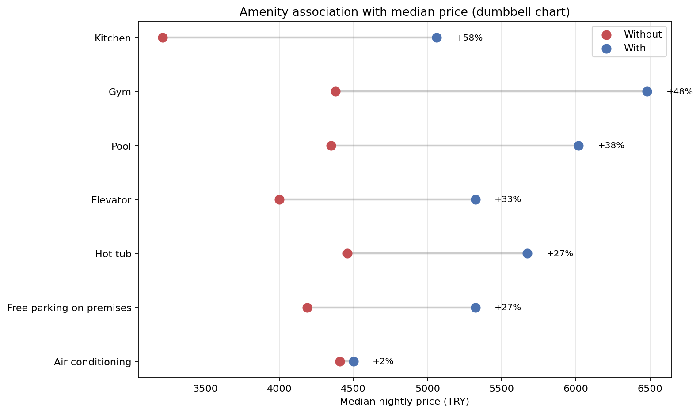

A dumbbell chart compares listings **with vs. without** selected amenities. The differences are **associations, not causal effects**: location, property type, and capacity may also influence price.

**Full interpretations and caveats:** [Four evidence-based findings](reports/insights.md)

## Machine learning results

The project uses **two complementary ML models**: unsupervised clustering for market segments, and supervised regression for advertised nightly-price estimation.

### A. Market segmentation · K-Means

Multiple cluster counts were evaluated using **silhouette score, elbow behaviour, and interpretability**. The final model uses **K = 3**.

| Clusters (K) | Recorded silhouette score |
|:---:|---:|
| **3 — selected** | **0.405** |
| 4 | 0.400 |
| 5 | 0.285 |

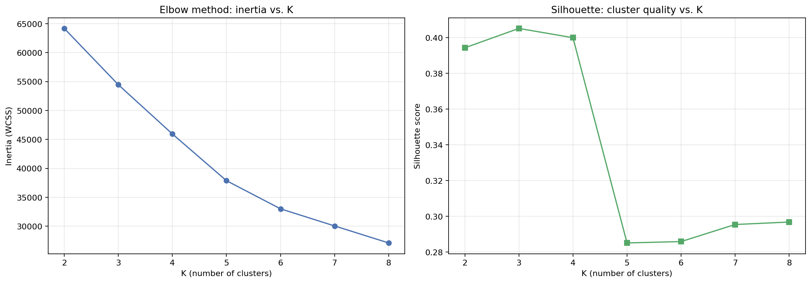

#### Segment distribution

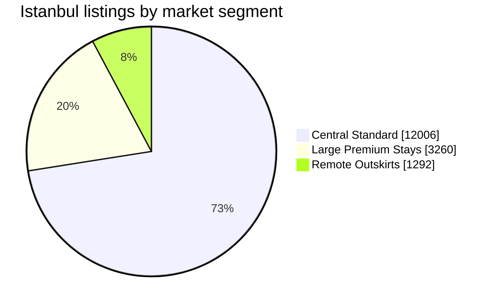

| Segment | Listings | Share¹ | Median nightly price | Typical capacity | Distance to centre |
|---|---:|---:|---:|---:|---:|
| **Large Premium Stays** | 3,260 | 19.7% | ~TRY 8,577 | 6 guests | 3.7 km |
| **Central Standard** | 12,006 | 72.5% | ~TRY 3,856 | 3 guests | 3.6 km |
| **Remote Outskirts** | 1,292 | 7.8% | ~TRY 4,000 | 3 guests | 28.9 km |
| **Total** | **16,558** | **100%** | — | — | — |

¹ Shares calculated from the recorded cluster counts; segment prices and profiles are approximate as reported in the implementation notes.

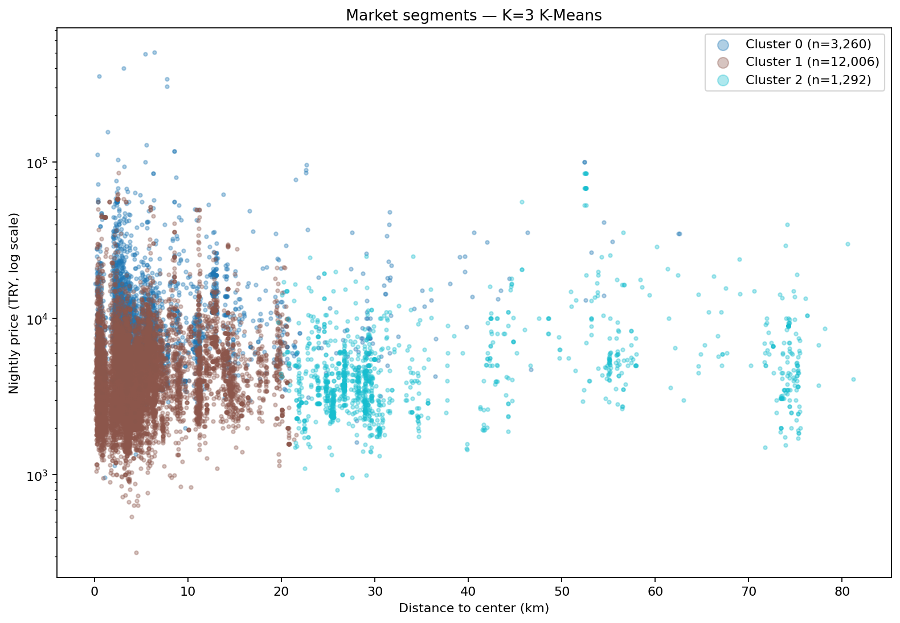

**Interpretation:** the Remote Outskirts cluster is distinguished primarily by **distance from the city centre**, not necessarily lower prices. The cluster labels are descriptive analytical categories, not objective property classifications.

[Clustering decisions](reports/clustering_decisions.md) · [Cluster profiles (CSV)](reports/clusters/cluster_profiles.csv)

### B. Nightly-price prediction · Regression

The prediction task estimates advertised nightly prices from listing characteristics available at prediction time. Four approaches were evaluated using a reproducible **80/20 train/test split**.

| Model | MAE ↓ (TRY) | RMSE ↓ (TRY) | R² ↑ |
|---|---:|---:|---:|
| Median baseline | 3,196.52 | 8,481.95 | −0.04 |
| Linear Regression | 2,506.45 | 7,786.61 | 0.12 |
| Ridge Regression | 2,496.21 | 7,779.52 | 0.13 |
| **HistGradientBoosting 🏆** | **1,971.70** | **7,232.33** | **0.24** |

**Selected model:** `HistGradientBoostingRegressor`, stored as a fitted preprocessing-and-model artifact in `models/price_pipeline.joblib`.

- **~21% lower MAE than Linear Regression** on the recorded evaluation.
- **~38% lower MAE than the median baseline** on the recorded evaluation.
- **R² = 0.24:** substantial uncertainty remains; estimates are directional rather than exact.
- **Log-target regression** and preprocessing pipelines are used to manage skewness and reduce leakage risk.
- **Reviews/ratings are excluded** from the cold-start predictor because new listings may not have them.

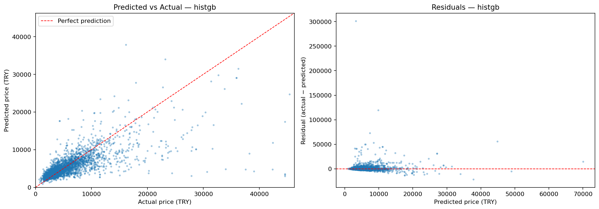

#### Known reliability limitations

The residual analysis identified **underprediction for very expensive listings** and unusually high error for **hotel rooms** (reported MAE about TRY 6,450 on 45 test samples). The API exposes a **heuristic `high` / `low` confidence label**; it is **not** a calibrated probability or prediction interval.

[Model comparison report](reports/model_comparison.md) · [Saved metrics JSON](reports/model_metrics.json)

## Web dashboard

The **React + TypeScript** frontend is implemented and connected to FastAPI through a typed client. It uses responsive desktop/mobile navigation, Recharts, Lucide icons, a custom Market Analyzer favicon/title, light and dark themes, and instant **English/Turkish language switching** implemented with React Context.

| Page | What's available |
|---|---|
| **Overview** | Active listings, median/P75 prices, average capacity, price histogram, top neighbourhoods |
| **Predict** | Backend-driven property options, validated form, estimated nightly price, confidence, market-segment badge |
| **Segments** | Three segment profile cards, market-share pie chart, normalized radar chart |
| **Model** | Selected model, MAE/RMSE comparison, saved residual visualization |
| **Data** | Pipeline architecture, source/clean row counts, validation status, localized quality metrics, artifact inventory |

The prediction form reads valid categories and feature bounds from the API. Rare property types with fewer than **50 listings** are excluded from the supported dropdown options.

<details>
<summary><strong>Interface and interaction principles</strong></summary>

- **Data-driven options:** no hard-coded list of neighbourhoods or property types.
- **Input validation:** numeric limits are supplied by the backend, with Pydantic providing server-side enforcement.
- **Prediction context:** display currency, model version, assigned segment, and confidence label.
- **Responsive UI:** compact navigation and chart layouts for smaller screens.
- **Theme and language:** independent light/dark toggle and complete English/Turkish translations without an external i18n library.
- **Error handling:** loading and API error states rather than assuming every request succeeds.

</details>

## API reference

The FastAPI service serves saved models and precomputed analytics. Interactive, auto-generated API documentation is available locally at **`http://127.0.0.1:8000/docs`**.

| Method | Endpoint | Description |
|---|---|---|
| `GET` | `/health` | Application health check |
| `POST` | `/api/v1/predict` | Estimated nightly price, segment and heuristic confidence |
| `GET` | `/api/v1/market/summary` | Market-level counts, prices, and percentiles |
| `GET` | `/api/v1/market/neighbourhoods` | Neighbourhood statistics (minimum 30 listings) |
| `GET` | `/api/v1/market/clusters` | Named segment profiles |
| `GET` | `/api/v1/market/distribution` | Histogram-ready distribution bins |
| `GET` | `/api/v1/market/model-metrics` | Recorded model-evaluation metrics |
| `GET` | `/api/v1/market/options` | Actual category options and validated input ranges |
| `GET` | `/api/v1/market/data-quality` | Cleaning row counts, validation checks, and localized quality-metric source data |
| `GET` | `/docs` | Swagger UI |

### Request and inference flow

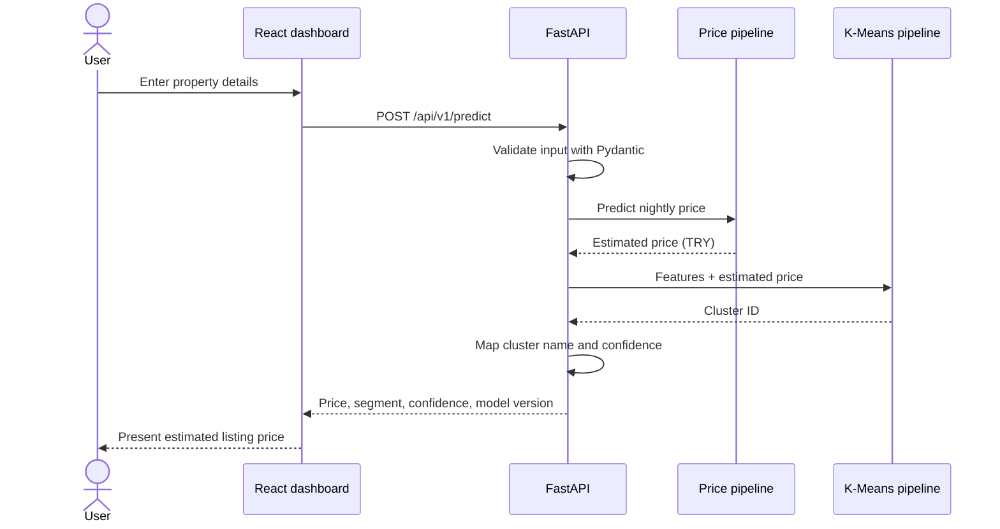

A key architecture decision is to **load both model artifacts and market data once at application startup** via FastAPI lifespan rather than reloading them for every request. Routes handle HTTP; services handle domain logic.

## Getting started

### Prerequisites

- **Python** and `pip`
- **Docker** and Docker Compose
- **Node.js** and `npm`
- The Istanbul September 2026 source snapshot and/or the generated local data/model artifacts

> [!NOTE]
> Source data and large model artifacts may not be committed to a public repository. If they are absent, download the appropriate source snapshot from [Inside Airbnb](https://insideairbnb.com/get-the-data/) and run the pipeline before starting the API. Follow [Inside Airbnb's data policies](https://insideairbnb.com/data-policies/) when using or sharing the data.

### 1. Clone and set up Python

```bash
git clone <YOUR_REPOSITORY_URL>
cd market-analyzer

python -m venv .venv
source .venv/bin/activate     # macOS / Linux
# Windows PowerShell: .venv\Scripts\Activate.ps1

python -m pip install -r backend/requirements.txt
```

Replace `<YOUR_REPOSITORY_URL>` with the real GitHub repository URL.

### 2. Start PostgreSQL

```bash
docker compose up -d
```

The development configuration maps PostgreSQL's container port **5432** to **localhost:5433**.

### 3. Prepare the data and models (when not already available)

Place the detailed source file at:

```text
data/raw/istanbul/2026-09/listings.csv.gz
```

Then, from the repository root, use the recorded pipeline commands:

```bash
python scripts/ingest_listings.py --city istanbul --snapshot 2026-09 --table listings

python scripts/clean_listings.py \
  --table listings \
  --output data/processed/listings_clean.parquet \
  --report data/processed/data_quality_report.json

python scripts/validate_pipeline.py
python scripts/train_clusters.py --n-clusters 3
python scripts/train_price_model.py --choose histgb
```

These commands reproduce the documented project workflow. Verify environment variables and source-file availability before running; retraining may update the recorded metrics and segment assignments.

### 4. Run the API

From the **repository root**:

```bash
uvicorn app.main:app --reload --app-dir backend
```

- **Health:** http://127.0.0.1:8000/health
- **Interactive API docs:** http://127.0.0.1:8000/docs

### 5. Run the frontend

In a separate terminal:

```bash
cd frontend
npm install
npm run dev
```

Open the local URL printed by Vite (typically **http://localhost:5173**).

The frontend defaults to **`http://127.0.0.1:8000`**. To use another API origin, set `VITE_API_BASE_URL` in the frontend environment. The backend reads allowed browser origins from `ALLOWED_ORIGINS` and defaults to **`http://localhost:5173`**.

## Testing and continuous integration

**Phase 8 added the automated quality layer** for data transformations, feature preprocessing, model serialization, API contracts, and frontend compilation.

### Tests and checks

| Layer | Coverage recorded in implementation notes |
|---|---|
| Cleaning | Price parsing, distance calculation, amenity counting |
| Features | Missing-value handling and preprocessing output |
| API | Health, prediction validation, cluster and market responses |
| Model | Saved joblib files can be loaded |
| Contracts | API request fields remain consistent with expected model features |
| Linting | Ruff import, unused-code, and undefined-name checks |
| Frontend | ESLint plus TypeScript/Vite production build |
| CI definition | Python dependency installation, Ruff, and pytest on pushes and pull requests |

```bash
# From the repository root
cd backend
PYTHONPATH=. pytest tests/ -v

# From the repository root (in a separate shell)
ruff check backend/
ruff format --check backend/

# Frontend checks
cd frontend
npm run lint
npm run build
```

On Windows PowerShell, set `$env:PYTHONPATH = "."` before running pytest from `backend/`.

**CI workflow definition:** [`backend/.github/workflows/ci.yml`](backend/.github/workflows/ci.yml) · **Ruff configuration:** [`backend/pyproject.toml`](backend/pyproject.toml)

> [!NOTE]
> GitHub discovers Actions workflows only from the repository-root `.github/workflows/` directory. The current workflow definition is stored under `backend/.github/workflows/`; move it to the root workflow directory before relying on hosted CI execution.

> [!TIP]
> The project records an actual model-serialization compatibility issue after a scikit-learn upgrade. The solution was to retrain and re-serialize the artifacts. Keep dependency versions pinned and load joblib files **only from trusted sources**.

## Project structure

<details>
<summary><strong>Expand repository layout (completed Phases 1–8)</strong></summary>

```text
market-analyzer/
├── backend/
│   ├── .github/workflows/ci.yml
│   ├── requirements.txt
│   ├── pyproject.toml
│   ├── app/
│   │   ├── main.py
│   │   ├── config.py
│   │   ├── schemas.py
│   │   ├── api/
│   │   │   └── routes/
│   │   │       ├── health.py
│   │   │       ├── predictions.py
│   │   │       └── market.py
│   │   ├── services/
│   │   │   ├── prediction.py
│   │   │   └── market.py
│   │   ├── db/
│   │   │   └── connection.py
│   │   ├── data/
│   │   │   └── cleaning.py
│   │   ├── analytics/
│   │   │   └── market_stats.py
│   │   └── ml/
│   │       ├── clustering.py
│   │       ├── features.py
│   │       └── training.py
│   └── tests/
│       ├── conftest.py
│       ├── test_api.py
│       ├── test_cleaning.py
│       ├── test_features.py
│       └── fixtures/
│           └── sample_listings.csv
├── frontend/
│   ├── public/
│   │   ├── favicon.svg             # Market Analyzer branding
│   │   └── residual_analysis.png
│   └── src/
│       ├── api/client.ts            # Typed FastAPI client
│       ├── components/Layout.tsx    # Responsive navigation and theme controls
│       ├── contexts/LanguageContext.tsx
│       └── pages/
│           ├── OverviewPage.tsx
│           ├── PredictPage.tsx
│           ├── SegmentsPage.tsx
│           ├── ModelPage.tsx
│           └── DataPage.tsx
├── scripts/
│   ├── build_analysis_dataset.py
│   ├── ingest_listings.py
│   ├── clean_listings.py
│   ├── validate_pipeline.py
│   ├── train_clusters.py
│   └── train_price_model.py
├── notebooks/
│   ├── 01_data_quality.ipynb
│   ├── 02_market_eda.ipynb
│   ├── 03_clustering_experiments.ipynb
│   └── 04_model_comparison.ipynb
├── data/
│   ├── README.md
│   ├── raw/istanbul/2026-09/
│   └── processed/
│       ├── listings_clean.parquet
│       └── data_quality_report.json
├── models/
│   ├── cluster_pipeline.joblib
│   └── price_pipeline.joblib
├── reports/
│   ├── insights.md
│   ├── clustering_decisions.md
│   ├── model_comparison.md
│   ├── model_metrics.json
│   ├── residual_analysis.png
│   ├── eda/
│   │   ├── price_distribution.png
│   │   ├── neighbourhood_prices.png
│   │   ├── geographic_prices.png
│   │   └── amenity_associations.png
│   └── clusters/
│       ├── elbow_silhouette.png
│       ├── cluster_profiles.csv
│       └── cluster_visualization.png
├── docker-compose.yml
└── README.md
```

</details>

## Engineering decisions

| Challenge | Implemented approach |
|---|---|
| Ingestion can partially fail | Atomic backup/load/verify/promote operation |
| PostgreSQL bind-parameter limit | Smaller multi-row insert batches |
| Monthly quotes disguised as nightly prices | Investigate pricing ratios and filter long-stay records |
| Preprocessing leakage | Train-only imputation within scikit-learn pipelines |
| Skewed market prices | Robust statistics and transformed-target experimentation |
| Small neighbourhood samples | Require at least 30 listings for rankings |
| Cluster labels changing across retraining | Explicit cluster-ID-to-name mapping |
| Clustering requires price for an unseen listing | Predict price before segment assignment |
| Rare/unsupported input categories | Data-driven dropdowns and API validation |
| Model startup overhead | Load artifacts once using FastAPI lifespan |
| sklearn pickle/joblib version mismatch | Retrain under the installed dependency versions |
| Future code regressions | Unit/contract tests, Ruff and GitHub Actions |

## Limitations

1. **Advertised ≠ booked:** listing prices do not tell us the final paid rate or actual earnings.
2. **Single city and snapshot:** the current results describe Istanbul in September 2026, not seasonal trends or future prices.
3. **Prediction error is material:** the current saved metrics report a holdout MAE of approximately TRY 1,972, with particularly large errors at the high end.
4. **Heuristic confidence only:** `high` and `low` flags are rule-based warnings, not calibrated probabilities.
5. **Hotel rooms are unreliable:** the documented hotel-room subgroup is small and has high prediction error.
6. **Location is an approximation:** neighbourhood labels and distance from one city-centre reference do not capture every location factor.
7. **Clustering is descriptive:** segment IDs may change on retraining, and price-sensitive clusters are not universal housing categories.
8. **Amenity differences are observational:** they do not establish causation.
9. **Data availability varies:** some fields, including bathrooms in the recorded snapshot, were unusable and omitted from training.

## Project roadmap

| Phase | Scope | Status |
|---|---|---|
| 01 | Database and ingestion | ✅ Completed |
| 02 | Cleaning and feature engineering | ✅ Completed |
| 03 | EDA and business insights | ✅ Completed |
| 04 | K-Means segmentation | ✅ Completed |
| 05 | Regression and evaluation | ✅ Completed |
| 06 | FastAPI inference and analytics | ✅ Completed |
| 07 | Five-page React dashboard, responsive navigation, themes, English/Turkish support | ✅ Completed |
| 08 | Backend tests, Ruff, frontend checks, and CI workflow definition | ✅ Completed |
| 09 | Public deployment and production configuration | 🔜 Planned |
| 10 | Final portfolio polish and demo | 🔜 Planned |

**Next milestones:** publish the frontend and API, verify cross-origin configuration and runtime artifacts in the hosted environment, record a real product demo, and keep screenshots/metrics synchronized with the deployed version.

<details>
<summary><strong>Potential future enhancements</strong></summary>

- Historical snapshots and time-based validation.
- Map-driven filters and richer neighbourhood geographic layers.
- Better calibration and prediction intervals.
- Stronger modelling for hotel rooms and ultra-premium listings.
- Optional external geographic and transport features.
- Further tests, deployment monitoring, and performance optimization.

</details>

## Data attribution and references

The underlying listing snapshot comes from **[Inside Airbnb](https://insideairbnb.com/)**. Please respect its [data policies](https://insideairbnb.com/data-policies/): attribute the project appropriately, download only the data you need, and avoid republishing raw datasets.

**Official documentation and resources**

- [Inside Airbnb — datasets and downloads](https://insideairbnb.com/get-the-data/)
- [Inside Airbnb — data policies](https://insideairbnb.com/data-policies/)
- [Inside Airbnb — data assumptions](https://insideairbnb.com/data-assumptions/)
- [FastAPI documentation](https://fastapi.tiangolo.com/)
- [scikit-learn documentation](https://scikit-learn.org/stable/)
- [React documentation](https://react.dev/)
- [GitHub — Mermaid diagrams in Markdown](https://docs.github.com/en/get-started/writing-on-github/working-with-advanced-formatting/creating-diagrams)

---

<div align="center">

**Built to connect data engineering, applied machine learning, API design, and frontend development in one reproducible project.**

*Dynamic Market Analyzer · Istanbul · September 2026*

</div>
